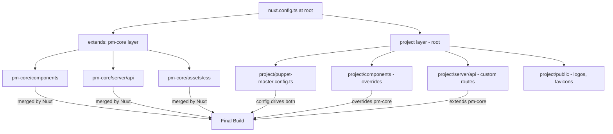
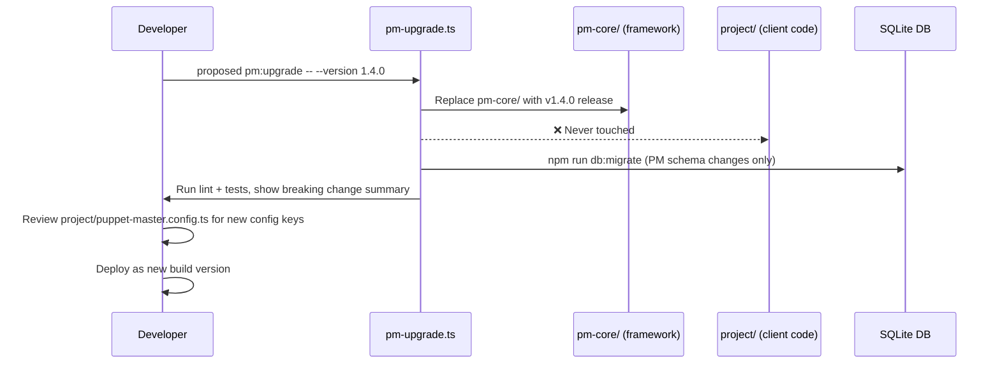

I have created the following plan after thorough exploration and analysis of the codebase. Follow the below plan verbatim. Trust the files and references. Do not re-verify what's written in the plan. Explore only when absolutely necessary. First implement all the proposed file changes and then I'll review all the changes together at the end.

## What I Observed

PM is currently a **monorepo-in-disguise**: the framework core (CSS system, atomic components, composables, API patterns, RBAC, DB schema, admin panel) and project-specific content (config values, seed data, logos, copy, custom sections) all live in the same flat directory. The `pmMode` flag (`unconfigured / build / develop`) is the only runtime separator. `framework.versions.json` and `CHANGELOG.md` already show semantic versioning discipline, and `docs/reference/framework-versioning.md` describes an upgrade flow — but it's manual and fragile because there's no physical boundary between "PM code" and "project code."

## Approach

The cleanest path — without rewriting PM into a published npm package (which would require a registry, versioning pipeline, and breaking the current single-repo workflow) — is a **layered directory contract** inside the same repo. You draw a hard line between `pm-core/` (owned by the framework team, never touched by project developers) and `project/` (owned by the client project). A thin **merge/upgrade script** replaces the current manual "pull and pray" upgrade flow. This keeps the Docker/Nitro/Nuxt build unchanged, avoids a monorepo tool (Turborepo, etc.), and is reversible.

---

## Implementation Plan

### 1. Define the Boundary — Canonical Directory Split

Establish two first-class namespaces inside the existing repo:

| Namespace | Path | Owner | Touched on upgrade? |
|---|---|---|---|
| **PM Core** | `pm-core/` | Framework team | ✅ Yes — replaced wholesale |
| **Project Layer** | `project/` | Project developer | ❌ Never touched by upgrade |
| **Shared contract** | `shared/` | Both (read-only interface) | Only additive changes |

**PM Core** contains everything that is framework-owned and version-controlled by the PM team:

```
pm-core/
  components/          # atoms, molecules, organisms, sections (all built-in)
  composables/         # useConfig, useAuth, useToast, useScrollSpy, etc.
  assets/css/          # The full 5-layer CSS system (~50 files)
  pages/               # admin/*, init.vue, login.vue, app/* shells
  server/
    api/               # All built-in API routes (auth, admin, setup, blog, faq…)
    database/          # schema.ts, seed.ts, migrations
    utils/             # auth.ts, audit.ts, validation.ts, password.ts
    plugins/           # sentry.ts, session cleanup
  types/               # config.ts, auth.ts, all shared types
  i18n/                # loader.ts, fallbacks.ts, i18n.config.ts
  plugins/             # sentry.client.ts, reveal directive
```

**Project Layer** contains everything that is project-specific:

```
project/
  puppet-master.config.ts   # The ONE file the developer edits
  assets/
    css/overrides.css        # Optional project-level CSS overrides (utilities layer only)
    fonts/                   # Project fonts
  components/                # Custom project components (not in PM core)
  pages/                     # Custom project pages beyond PM shells
  public/                    # Logos, favicons, OG images
  content/                   # Static content files if any
  server/
    api/                     # Custom project API routes
    database/
      project-schema.ts      # Additional tables (appModules)
      project-seed.ts        # Project seed data
```

---

### 2. Nuxt Layer System — The Glue

Nuxt 4's native **layer system** (`extends` in `nuxt.config.ts`) is the mechanism that merges PM Core and the Project Layer at build time — no custom tooling needed.

Update `nuxt.config.ts` at the repo root:

- Set `extends: ['./pm-core']` so Nuxt auto-merges components, composables, pages, server routes, and CSS from PM Core.
- The project layer (current `app/` directory, renamed to `project/`) sits at the root and **overrides** anything from PM Core by convention (Nuxt layers resolve last-wins).
- `puppet-master.config.ts` moves to `project/` and is the only file a project developer needs to touch.

This means:
- PM Core components are auto-imported with their existing prefixes (`AtomsLogo`, `MoleculesBlogPostCard`, etc.) — **zero breaking change** for existing projects.
- A project can override any PM Core component by placing a same-named file in `project/components/`.
- CSS overrides go in `project/assets/css/overrides.css` inside the `utilities` layer — respecting the 5-layer contract.



---

### 3. The Config Contract — Single Source of Truth

`puppet-master.config.ts` stays exactly as it is today (the `PmConfig` type in `pm-core/app/types/config.ts` is already well-defined). Move it to `project/puppet-master.config.ts`.

This is the **only configuration file** a project developer edits. Runtime code imports the canonical project config path directly; no legacy `@config` alias is kept.

---

### 4. Database Schema Composition

The current `server/database/schema.ts` mixes PM-owned tables (users, sessions, blog, faq, etc.) with project-specific tables. Split it:

- `pm-core/server/database/schema.ts` — all PM-owned tables (users, sessions, roles, blogPosts, faqItems, pricingTiers, etc.)
- `project/server/database/project-schema.ts` — project-specific tables (appModules tables)
- `drizzle.config.ts` at root imports both and merges them for migrations

This means `npm run db:push` still works identically. Project tables are additive — PM upgrades never touch `project-schema.ts`.

---

### 5. The Upgrade Script — proposed `pm:upgrade`

Replace the current manual "pull and merge" flow with a deterministic script at `scripts/pm-upgrade.ts`:

```
scripts/
  pm-upgrade.ts     # New: upgrade PM Core to a target version
  pm-diff.ts        # New: show what changed between current and target PM version
```

The upgrade script:

1. Reads the target PM version from `framework.versions.json` (already exists).
2. Downloads or pulls the target PM Core release (git subtree, git submodule, or a tarball from a PM releases repo).
3. Replaces `pm-core/` wholesale — **never touches `project/`**.
4. Runs `npm run check:versions` (already exists).
5. Runs `npm run db:migrate` to apply any new PM schema migrations.
6. Runs `npm run lint` and `npm run test:run`.
7. Reports a diff of breaking changes from the PM release notes (`docs/releases/<version>.md`).

The upgrade is **safe by construction** because `project/` is never in scope.



---

### 6. Plugin System — Opt-In PM Modules

The existing `modules` config key in `puppet-master.config.ts` already acts as a plugin registry. Formalize it:

- Each PM module (blog, pricing, scrollytelling, portfolio, etc.) lives in its own subdirectory inside `pm-core/`:

```
pm-core/
  modules/
    blog/
      components/      # BlogPostCard, BlogList, etc.
      pages/           # /blog, /blog/[slug]
      server/api/      # /api/blog/*, /api/admin/blog/*
      server/database/ # blogPosts, blogPostTranslations tables
      assets/css/      # blog.css
    pricing/
      ...
    scrollytelling/
      ...
    portfolio/
      ...
```

- Nuxt's layer system conditionally includes module directories based on `config.modules.<id>.enabled` — this can be done via a `nuxt.config.ts` hook that reads the config and adds/removes layer paths dynamically.
- Disabled modules contribute **zero** code to the build (no dead CSS, no unused routes).

This is the key architectural win: **scrollytelling, Three.js, and `postprocessing`** (already chunked separately in `nuxt.config.ts` as `vendor-three` and `vendor-postprocessing`) only enter the bundle when `config.features.scrollytelling: true`.

---

### 7. Version Governance — `framework.versions.json` Extension

Extend the existing `framework.versions.json` to include:

| Field | Purpose |
|---|---|
| `pmCoreVersion` | Current PM Core version installed in `pm-core/` |
| `pmCoreMinCompatible` | Minimum PM Core version this project config is compatible with |
| `projectSchemaVersion` | Project DB schema version (separate from PM schema) |

`npm run check:versions` (already exists) validates these fields. A project that tries to run PM Core `1.5.0` against a config written for `1.2.0` gets a clear error with a migration guide link.

---

### 8. Migration Path for Existing Projects

For the current codebase (everything in one flat `app/` directory):

1. Create `pm-core/` and `project/` directories.
2. Move all PM-owned files into `pm-core/` (components, composables, server/api built-ins, CSS system, types, i18n).
3. Move project-specific files into `project/` (`puppet-master.config.ts`, `public/`, any custom components/pages).
4. Update `nuxt.config.ts` to use `extends: ['./pm-core']`.
5. Update runtime imports to read `project/puppet-master.config.ts` directly.
6. Run `npm run build` — the Nuxt layer merge produces an identical output to today.
7. Tag this state as the first versioned PM Core release (e.g., `pm-core-v1.3.1`).

All future client projects are initialized by:
- Cloning the repo.
- Running `npm run init` (already exists) — which now only writes to `project/`.
- Never touching `pm-core/`.

---

### 9. What Each Role Touches

| Role | Files they touch | Files they never touch |
|---|---|---|
| **PM Framework Developer** | `pm-core/**` | `project/**` |
| **Project Developer** | `project/puppet-master.config.ts`, `project/components/`, `project/server/api/`, `project/public/` | `pm-core/**` |
| **Content Editor** | Admin UI (database content) | Both code layers |
| **Upgrade Script** | `pm-core/**`, `framework.versions.json` | `project/**` |
