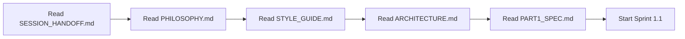

# Migration Documentation Package

**Snapshot:** `pre-migration-2026-07-18`  
**Source directory:** `.../nikitat/app` (Nuxt 4 + Puppet Master)  
**Target directory:** To be created (SvelteKit)  
**Purpose:** Complete context preservation for AI-driven migration  

---

## Document Map

| # | Document | What it contains | When to read |
|---|----------|-----------------|--------------|
| 1 | `PHILOSOPHY.md` | **AI-First framework philosophy** — why this rewrite exists, what principles drive every decision | **First.** Before anything else. |
| 2 | `CODEBASE_ANALYSIS.md` | Complete analysis of current Nuxt/PM codebase — all 500+ files, 77k LOC | After philosophy, before architecture |
| 3 | `ARCHITECTURE.md` | **Target architecture** on SvelteKit — data flow, module boundaries, hooks, stores | Before starting Part 1 |
| 4 | `COMPONENT_CATALOG.md` | Full inventory of all 51+ components with props, states, translations | During Part 1 implementation |
| 5 | `ROUTE_MAP.md` | All routes: 6 public pages, 17 admin pages, 40+ API endpoints | During Part 1 implementation |
| 6 | `DATABASE_SCHEMA.md` | All 19 tables, relationships, translation pattern | During DB porting |
| 7 | `ROADMAP.json` | Machine-readable 4-part plan, 39 sprints | Always — track progress |
| 8 | `ROADMAP.md` | Human-readable 4-part plan with timelines | Planning |
| 9 | `PART1_SPEC.md` | Detailed spec for Part 1: Nuxt → SvelteKit (15 sprints) | During Part 1 |
| 10 | `STYLE_GUIDE.md` | **AI-Driven development conventions** — how to write code for this project | Before writing any code |
| 11 | `SESSION_HANDOFF.md` | **Start here** — what this chat decided, where to begin in new session | When opening new AI session |

---

## Quick Start for New Session



---

## 4 Parts at a Glance

```
PART 1: Nuxt → SvelteKit    (15 sprints, ~48 days)
  └── Full stack migration — everything works, old CSS preserved

PART 2: CSS → Tailwind      (8 sprints, ~17 days)
  └── Replace Pure CSS with Tailwind + custom tokens

PART 3: Security Hardening  (8 sprints, ~12 days)
  └── Maximally secure on SvelteKit — audit + enhance

PART 4: Performance         (8 sprints, ~15 days)
  └── Optimize for speed — SSR, bundles, images, CWV
```

---

## Key Decisions (already made)

| Decision | Value |
|----------|-------|
| **Framework** | SvelteKit (Svelte 5, runes API) |
| **CSS** | Tailwind CSS v4 + custom design tokens |
| **Database** | SQLite + Drizzle ORM (same as current) |
| **ORM** | drizzle-orm + better-sqlite3 (stay) |
| **i18n** | typesafe-i18n with DB loader (same pattern) |
| **Auth** | Custom session-based + RBAC (same pattern) |
| **Validation** | Zod (stay) |
| **Animations** | GSAP + Three.js (stay — framework-agnostic) |
| **Icons** | Tabler Icons via @iconify/svelte |
| **API envelope** | `{ success: true, data }` (stay) |
| **State** | Svelte 5 runes ($state, $derived, $effect) — no Pinia |
| **Component hierarchy** | Simplified: ui/ + sections/ + portfolios/ (no 5-level atomic) |
| **Config** | Config file stays, but slimmer — generates TypeScript types |
| **Security** | Same model: session cookies, CSRF, CSP, rate limiting, audit |
| **Deployment** | Docker + Node adapter (same infra) |
