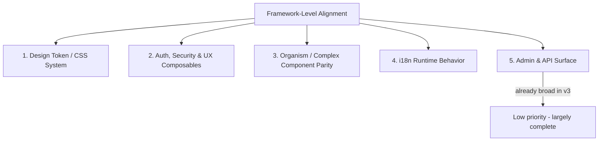

# Framework-Level Audit: PM v3 (SvelteKit) vs PM v2 (Nuxt)

## Purpose

Before any FABRICA22 project-level content/visual parity work begins, the **framework itself** (Puppet Master v3) must be validated as a solid, self-sufficient base — i.e. it must offer equivalent architectural capabilities to PM v2, even if implemented very differently (Tailwind utilities vs global BEM CSS, Svelte stores vs Vue composables).

This spec captures the comparative structure of both frameworks and defines the audit dimensions and known gaps.

## Scope Boundary



Project-level parity (matching FABRICA22's actual content, pages, and visual design 1:1 with `app-nuxt/`) is explicitly **out of scope** until this framework audit's findings are resolved — per your direction: *"we can't create a framework-based project before we have a solid framework basis."*

## 1. Component Architecture Comparison

| Layer | PM v2 (`app-nuxt/app/components/`) | PM v3 (file:app/src/lib/components/) | Notes |
| --- | --- | --- | --- |
| atoms | 12 components | 25+ components (incl. loading, social icons) | v3 consolidated loading atoms here — fine, naming convention difference only |
| molecules | 20 components (incl. `TeamMemberCard`, `HeroAnimatedLogo`, `TwoFactorSetup/Verify`) | 14 components | **Gap**: `TeamMemberCard`, `HeroAnimatedLogo`, `TwoFactorSetup`, `TwoFactorVerify` have no confirmed v3 equivalent |
| organisms/complex | 13 organisms (`PricingTiers`, `PricingComparison`, `BlogPostsGrid`, `TeamGrid`, `ChangePasswordModal`, `OnepagerThreeStoryScene`, etc.) | 8 complex components (`TheHeader`, `TheFooter`, `SectionRenderer`, `Onepager`, `ToastContainer`, `CookieConsent`, `ConfirmDialog`) | **Gap**: pricing/blog/team "grid/tiers/comparison" organisms and password-change/3-story-scene components not present in v3 — need to confirm if folded into sections or genuinely missing |
| sections | 13 sections | 13 sections (registry-driven) | ✅ Parity — same section set (about, blog, faq, features, focus, hero, pricing, portfolio, contact, team, testimonials, clients) |
| portfolios/plugins | 4 viewer components | 4 viewer components (`plugins/portfolio/`) | ✅ Parity |

## 2. CSS / Design System Comparison

PM v2 uses a **5-layer global CSS architecture**:

```
colors/ (primitives, auto light-dark)
typography/ (variables, base, font-faces, lang overrides)
common/ (flexbox, effects, utilities, spacing, grid, sizing, text, scrollbars, a11y, edge-cases)
layout/ (page, grid, containers, breakpoints, responsive, admin-*)
skeleton/ (header, footer, nav, mobile-nav, bottom-nav, social-nav)
ui/ (forms, overlays, layouts, content/*.css — ~45 component-specific stylesheets)
runtime/ (per-section runtime CSS — 20 files, one per section/admin surface)
animations/ (keyframes, transitions, page-transitions, reveal, scrollytelling)
```

PM v3 uses **Tailwind v4 with a single ****`app.css`**:

- `@theme` block (brand colors, gray scale, typography scale, shadows, radii, z-index, transitions, spacing, container widths)
- `@layer base` (reset, dark-mode overrides, root vars)
- `@layer components` (hamburger animations, fixed header — explicitly restricted to "framework infrastructure ONLY" per file:app/AGENTS.md)
- `@utility` directives for reusable multi-property patterns
- Page-transition CSS, scroll-reveal system, keyframes

**Audit finding**: v3's `@theme` token set needs to be checked line-by-line against v2's `colors/primitives.css` + `typography/variables.css` + `layout/*` for **token coverage gaps** (e.g., does v3 have equivalents for every spacing/sizing/shadow/z-index token v2 defines?). Given v2's `light-dark()` CSS function usage vs v3's `dark:` Tailwind variant, the **theming mechanism differs fundamentally** — this is an intentional framework-generation difference (v3 rule #1: no raw values, Tailwind utilities only), not a bug, but must be confirmed as *functionally complete* (same color modes, same contrast/accessibility guarantees).

## 3. State Management & Composables Comparison

| Concern | PM v2 (Nuxt composable) | PM v3 (Svelte store/action) | Status |
| --- | --- | --- | --- |
| Theme | — (CSS `light-dark()`) | `stores/theme.svelte.ts` | ✅ |
| Settings | `useSiteSettings` | `stores/settings.svelte.ts` | ✅ |
| Content | — | `stores/content.svelte.ts` | ✅ |
| Navigation | `useWebsiteNavigation`, `useScrollSpy`, `useScrollHeader` | `stores/navigation.svelte.ts`, `actions/scrollSpy.ts`, `actions/scrollHeader.ts` | ✅ |
| Reveal/Parallax/Scrollytelling | `useReveal`, `useScrollytelling`, `plugins/scrollytelling.ts` | `actions/reveal.ts`, `actions/scrollyScene.ts`, `actions/parallax.ts` | ✅ likely parity — confirm scrollytelling multi-scene behavior matches |
| Auth | `useAuth`, `middleware/auth.ts` | `server/auth/session.ts`, `server/auth/password.ts`, `server/auth/totp.ts`, `server/auth/lockout.ts` | Needs confirmation: TOTP exists server-side (`totp.ts`) but **no ****`TwoFactorSetup`****/****`TwoFactorVerify`**** UI component found in v3** |
| CSRF | `useCsrf`, `plugins/csrf.client.ts` | `server/security/csrf.ts` | Server-side present; **client-side composable/helper not confirmed** |
| Toast | `useToast` | `stores/*` + `complex/ToastContainer.svelte` | Likely ✅ — confirm store exists |
| Confirm dialog | `useConfirm` | `complex/ConfirmDialog.svelte` | Likely ✅ — confirm store/action backing it |
| WebSocket / unread count | `useWebSocket`, `useUnreadCount` | `api/admin/contacts/unread/+server.ts` (polling?) | **Gap/Change**: v3 appears to use REST polling instead of WebSocket — confirm this is an intentional architecture decision, not a missed capability |
| Pagination | `usePagination` | `server/utils/pagination.ts` (server-only) | Confirm client-side pagination UI pattern exists somewhere (admin data tables) |
| Media query / A11y / Performance | `useMediaQuery`, `useA11y`, `usePerformance` | Not found | **Gap** — confirm whether these are unnecessary in v3 (e.g., Tailwind responsive variants replace `useMediaQuery`) or genuinely missing |
| Cookie consent | `useCookieConsent` | `complex/CookieConsent.svelte` | Confirm backing state logic exists |
| Form dirty tracking | `useFormDirty` | Not found | **Gap** — needed for admin forms UX parity |
| Logo resolution | `useLogo`, `utils/made-by-logo.ts` (v3 has `made-by-logo.ts` too) | `utils/made-by-logo.ts` | ✅ |

## 4. i18n Runtime Comparison

v2 enforces (`app-nuxt/AGENTS.md`):

- Zero raw string literals — all through `t()`
- Translation cache loaded at server start (`translationCache`), requires restart after seeding
- `translateHeading()` mapping for portfolio section headings
- Fallback chain: translated content → translated section headings → never raw text
- EN/FR/HE completeness requirement per content field

v3 has: `server/db/translations-cache.ts`, `server/services/translations.ts`, `i18n.ts`. **Audit finding**: confirm the same cache-invalidation-on-restart behavior, the same fallback chain discipline, and whether `translateHeading()`-equivalent mapping exists for portfolio section headings in v3's `server/services/portfolio.ts`.

## 5. Admin & API Surface Comparison

v3's file:app/src/routes/admin/ and file:app/src/routes/api/ already implement full CRUD for blog, faq, features, pricing, portfolios (+ items), team, testimonials, clients, users, roles, translations, settings, health, audit-logs, ops, support-bundle, terminal — this **exceeds or matches** what's visible in v2's `pages/admin/*`. This dimension is judged **largely complete** and low priority for the framework-alignment pass; only the 2FA/change-password UI gap (section 3 above) is a confirmed sub-item here.

## Audit Deliverable

For each numbered gap above, produce a definitive **present/absent/intentionally-changed** determination with file-level evidence, before any code changes are proposed. This spec is the audit checklist; the tickets below break the remediation work into the minimal necessary set once gaps are confirmed real.