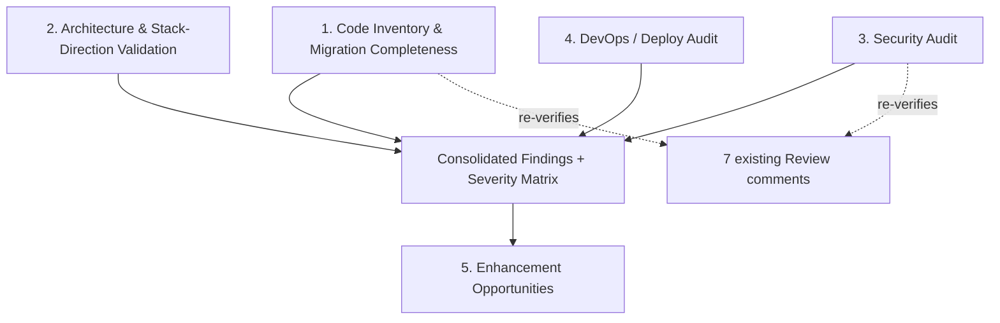

# PM2→PM3 Full Review — Audit Plan & Methodology

## Problem & Context

Puppet Master is transitioning from v2 (Nuxt + custom CSS, human-dev-optimized) to v3 (SvelteKit + Tailwind v4, AI-agent-dev-optimized). The codebase already contains prior audit artifacts (file:docs/traycer/Framework-Level_Audit__PM_v3_`(SvelteKit)_vs_PM_v2_(Nuxt).md`, file:docs/traycer/Review___PM2_to_PM3_Migration_Review.md) with unresolved findings, but no one has answered, with current evidence, whether the migration is complete, whether the stack choice is still correct for AI-driven development, whether the framework/project split is real, whether security is sound, and whether the deploy pipeline is production-ready.

This review has no code changes and no user-facing behavior — it produces one consolidated diagnostic spec that becomes the input for a future `ticket-breakdown`. The constraint is that findings must be evidence-based (file-level citations), not assumptions, and severity must be explicit so remediation can be prioritized.

## Technical Approach

### Architectural Approach

**Audit organization — by layer, not by original question order.** The five layers below fully cover your six original questions while avoiding duplicate investigation (e.g., framework/project segregation naturally surfaces inside the code-inventory layer):

**Layer 1 — Code Inventory & Migration Completeness** (answers Q1, Q3)

- Build a full mapping table: every file:app-nuxt/app/pages/*, file:app-nuxt/app/components/**, file:app-nuxt/server/api/** route, and each of the 31 DB tables → its PM3 equivalent (file:src/routes, file:src/lib/components, file:src/lib/server/services) or explicit "missing/stub" flag.
- For each mapped pair, capture three independent verdicts: **code parity** (does equivalent logic exist), **visual/UX parity** (does rendered output/behavior match — inspected via reading component markup/props, not live screenshots, since no browser access exists), **content-migration parity** (is real seed/content data present, not just schema — cross-check file:project/content.json vs file:src/project/content.json row-by-row for populated fields).
- Re-verify framework/project segregation claims in file:docs/framework-project-boundary.md against actual current code (is `SectionRenderer` still hardcoding names per Review Comment 1? are team/testimonials/clients still stubs per Comment 4?).
- Re-verify all 7 existing review comments against current code state — assign each a fresh verdict: Fixed / Partially Fixed / Still Open, with file/line evidence.

**Layer 2 — Architecture & Stack-Direction Validation** (answers Q2, Q6)

- Evaluate each major stack choice (SvelteKit vs alternatives, Tailwind v4 token system, Drizzle ORM, Paraglide i18n, Zod validation, Vitest/Playwright) specifically against "AI-agent-driven development" criteria: predictability/lack of implicit magic, explicitness of data flow, ease of static analysis/lint enforcement, quality of guardrails (the `pm3-validator.mjs` enforcement layer is a strong existing signal here).
- Where a choice is suboptimal for AI-driven dev, name a concrete alternative and the trade-off — not just "consider X."
- Fold in enhancement ideas (Q6) here: opportunities like stronger static enforcement, better component contracts, missing dev-agent tooling (e.g., are there `AGENTS.md`/MCP rule files kept current, is there drift risk).

**Layer 3 — Security Audit** (answers Q4)

- Systematically review: session/auth (file:src/lib/server/auth/*), CSRF (file:src/lib/server/security/csrf.ts), rate limiting & lockout, CSP/security headers (file:src/lib/server/security/headers.ts — re-verify Comment 7's `unsafe-inline` finding against current code), input validation coverage on all POST/PUT/PATCH routes (Zod on every admin/public API route), RBAC enforcement (re-verify Comment 2), file upload validation, secrets handling (`.env.example` vs required env vars), and dependency posture (any known-vulnerable packages in `package.json`).
- Cross-reference against PM2's security baseline (file:docs/archive/pm-v2/reference/security.md, `docs/security-legal-audit.md` in app-nuxt) to confirm no regressions were introduced during migration.

**Layer 4 — DevOps / Deploy Audit** (answers Q5)

- Audit file:ansible/ roles (common, security, monitoring, docker, deploy-user), file:Dockerfile, `.dockerignore`, and any CI/CD config as code — compare against file:app-nuxt/ansible/ to confirm true parity (not a stale copy) and evaluate whether Ansible is still the right choice or whether the target should be reconsidered (e.g., simpler container-native approaches) given the AI-agent-driven-dev goal.
- Produce the manual-verification checklist deliverable (a discrete section) listing exactly what to check on the live server that cannot be verified from code alone (actual running container versions, TLS cert status, firewall rules, live env var values, actual CSP header served, DB backup cadence, monitoring alerting reachability).

**Layer 5 — Enhancement Opportunities**

- A shorter, forward-looking section separate from the gap list — ideas that go beyond "fix what's broken," e.g., stronger automated i18n-literal enforcement, visual regression testing for section parity, a real `@puppet-master/core` package boundary (currently aspirational per file:docs/framework-project-boundary.md line 76-81).

### Findings Document Structure

The final consolidated review spec will use this structure:

1. Executive Summary — overall migration % complete, overall direction verdict (aligned / needs correction), top 5 critical items
2. Layer 1 — Code Inventory & Migration Completeness (full mapping table + 7-comment re-verification table)
3. Layer 2 — Architecture & Stack-Direction Validation
4. Layer 3 — Security Audit
5. Layer 4 — DevOps / Deploy Audit + Manual Verification Checklist
6. Layer 5 — Enhancement Opportunities
7. Prioritized Findings/Gaps Matrix (single consolidated table, all layers combined)

**Severity model** (applied uniformly across all findings):

| Tier | Meaning |
| --- | --- |
| Critical-Security | Exploitable or high-risk security gap (e.g., CSP unsafe-inline, missing input validation) |
| Critical-Functional | Breaks core migration goal — feature missing/broken, framework/project boundary violated |
| Important | Should be fixed before wider rollout but not actively dangerous or broken |
| Nice-to-have | Enhancement or polish, no urgency |

### Constraints & Boundaries

- No code changes will be made during this review — it is read-only investigation producing one spec.
- Visual/UX parity is assessed by reading component markup, props, and data flow (no live browser rendering or screenshots available) — this is a documented limitation, not a gap in the method.
- Live production state (actual deployed server) is not directly inspectable — Layer 4 splits into code-auditable findings plus a manual checklist handed back to the user.
- Output of this review is findings only — no tickets are created in this pass; `ticket-breakdown` is a separate, later step.