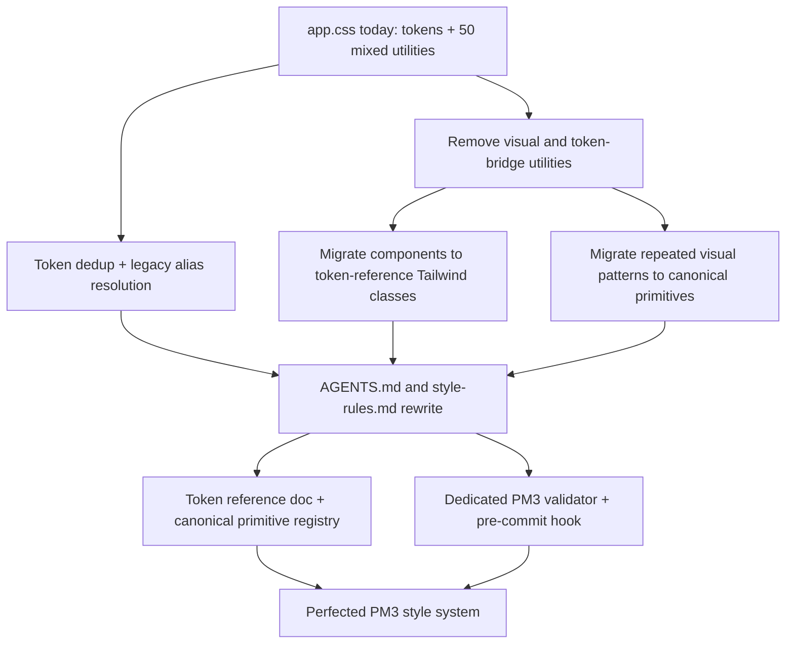

# PM3 Bulletproof Style System — Tokens-Only CSS Architecture

## Problem & Context

PM v3's file:src/app.css (1733 lines) mixes design tokens, base resets, framework infrastructure, and ~50 custom `@utility` classes in one undifferentiated file, with no enforced boundary between "token" (safe to reuse), "shared visual pattern" (risky — affects multiple components silently), and "component-local" (safe to change freely). This has caused repeated, confirmed AI-agent failures when making simple style changes:

- Agent can't find which file/token/utility controls a given visual property
- Agent doesn't realize an existing token/utility already covers a need, and invents a duplicate (confirmed: `--z-base` through `--z-toast` are defined twice, identically, in the same `@theme` block)
- Agent changes a class but the visual result doesn't change because a `@utility`/`@layer components` rule elsewhere overrides it
- Agent changes something and unexpectedly breaks other components sharing the same class
- Agent can't tell whether a change is framework-wide or component-local

file:AGENTS.md currently documents rules that are part of the problem: Rule A.1 promotes named token-bridge utilities (`px-container`, `max-w-container`, `text-fluid-*`), and Rule A.2 explicitly allows "reusable multi-property patterns" as `@utility` (e.g. `focus-card`, `contact-card`). In practice this has produced disguised BEM-style classes (`btn-style` in file:src/lib/components/sections/SectionContact.svelte) even though a canonical `<CtaButton>` component (file:src/lib/components/atoms/CtaButton.svelte) already exists for that exact purpose — evidence that today's rules do not prevent primitive bypass.

Separately, file:AGENTS.md rule D.12 claims a pre-commit hook blocks arbitrary CSS values, but no such hook (no husky/lint-staged config) exists in the repo — the documented enforcement is aspirational, not real.

This work rebuilds PM v3's style system from the ground up as an intentionally breaking-change redesign (per explicit direction — PM v3 has no obligation for backward compatibility with its own past conventions). The goal: a style architecture where every visual property of every component has exactly one possible source, agents never need to guess about overrides, and violations are caught mechanically rather than by review.

## Technical Approach — Architectural Approach

### 1. Shared CSS collapses to two categories only

**A. Design tokens (****`@theme`**** in **file:src/app.css** + **file:project/theme.css**)** — the only "shared style surface" agents reuse directly. Deduplicated (the exact-duplicate z-index block removed), legacy "kept for Phase 4+ compat" aliases resolved (deleted if unused after a full usage grep, retained with an explicit tracking comment if still referenced).

**B. Framework infrastructure exceptions** in `@layer components` / raw CSS — reserved strictly for things that cannot be expressed as inline Tailwind utility classes on a component: keyframe animations, page-transition mechanics, pseudo-element/browser-specific fixes, view-transition API hookups. Every exception requires an inline comment stating why it cannot be inline.

**Removed entirely:** all custom `@utility` classes that exist purely to bridge a token into a class name (`px-container`, `max-w-container`, `h-header`, `min-h-hero`, etc.) and all custom `@utility` classes that encode component-level visual appearance (`focus-card`, `contact-card`, `btn-style`, `section-title`, `about-visual`, `mobile-nav-panel`, etc.). This is a deliberate reversal of the current Rule A.1/A.2 guidance.

### 2. Token-reference contract (closes the ambiguity gap found in validation)

Component markup replaces removed utilities with direct Tailwind class strings referencing `@theme`/root tokens. A precise, mechanically-checkable contract defines what's legal:

- **Allowed:** bracket syntax composed entirely of token references — `var(--token)`, `calc()`/`min()`/`max()`/`clamp()` wrapping only token references and unitless/safe operators, e.g. `h-[var(--h-header)]`, `pt-[calc(var(--h-header)+var(--space-8))]`
- **Forbidden:** literal colors, literal px/rem/%/ch values in bracket syntax, and any mix of a token reference with an ad hoc literal not itself promoted to a token first (e.g. `px-[max(var(--space-6),calc((100vw-var(--container-default))/2))]` must have every literal like `100vw` justified as intentional viewport math, not a smuggled magic number — literals that recur must be promoted into a named token)

### 3. Reuse via Svelte component composition, not shared CSS

Where a visual pattern repeats across components, the fix is a Svelte atom/molecule, not a retained `@utility`. Existing primitives already following this model — file:src/lib/components/atoms/CtaButton.svelte, file:src/lib/components/atoms/Container.svelte, file:src/lib/components/molecules/SectionHeading.svelte — become the **canonical, non-bypassable path** for their respective patterns (buttons, width containers, section titles). Their internal implementations are migrated off removed token-bridge utilities onto direct token references. Any component-level usage still doing it manually (e.g. `btn-style` in `SectionContact.svelte`) is migrated to use the canonical primitive.

### 4. Rule-source rewrite (in scope, not a side effect)

file:AGENTS.md (Rules A.1, A.2) and file:docs/contributing/pm-v3-style-rules.md are rewritten as part of this work to reflect the new policy: tokens + infra-only shared CSS, direct token-reference bracket syntax as the AGENTS.md-documented pattern, and mandatory primitive-first usage for buttons/containers/section headings/etc. Old guidance promoting token-bridge or visual `@utility` classes is removed, not left contradicting the new system.

### 5. Discoverability — two lookup layers

- **Token reference doc** (`docs/design-tokens.md`) — every `@theme`/root token, its purpose, example usage.
- **Canonical primitive registry** — a section in file:AGENTS.md (or a dedicated `docs/contributing/canonical-primitives.md`) listing the non-bypassable components (Button, Container, SectionHeading, Card patterns, etc.) agents must check before writing a new inline class bundle for a common pattern.

### 6. Enforcement — dedicated framework validator + real pre-commit gate

Not an extension of file:eslint-plugin-ssr-safety.js (wrong abstraction — that plugin is narrowly scoped to SSR config-access AST checks). Instead, a new, dedicated PM3 framework validator script is the single source of truth for:

- No duplicate token definitions in file:src/app.css / file:project/theme.css
- No new custom visual or token-bridge `@utility` additions
- No unjustified `@layer components` additions (missing "why inline is impossible" comment)
- No forbidden raw/arbitrary bracket values (per the token-reference contract in §2)
- No literal-value duplication appearing 2+ times inline (signal to promote to a token)
- No bypass of canonical primitives where one exists (e.g. hand-rolled button styling instead of `<CtaButton>`)

This validator is wired into a real husky + lint-staged pre-commit hook, replacing the currently-aspirational, non-existent hook described by Rule D.12.

### Migration approach

Single coordinated pass across tokens, `@utility` removal/migration, rule-source rewrite, docs, and enforcement — not phased — since a partially-migrated state (some components on old utilities, some on new token-reference classes) would itself reintroduce the exact ambiguity this work eliminates. Visual regression risk from touching many components at once is accepted as a trade-off and must be covered by a verification pass (manual/visual check of all sections and admin surfaces) before considering the work complete.