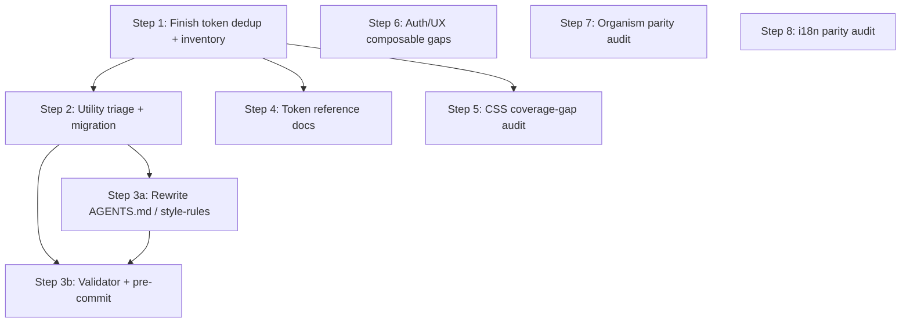

I have created the following plan after thorough exploration and analysis of the codebase. Follow the below plan verbatim. Trust the files and references. Do not re-verify what's written in the plan. Explore only when absolutely necessary. First implement all the proposed file changes and then I'll review all the changes together at the end.

## Observations

The four docs in `docs/traycer/` belong to one Epic ("Aligning SvelteKit+Tailwind Framework with Nuxt+Custom CSS") with 3 specs and 9 tickets. Cross-checking against the real codebase:

- **Ticket "Audit and Deduplicate Design Tokens"** is marked *In Progress* but is **not actually done**: `src/app.css` still declares `--z-base…--z-toast` twice (lines 128–138 and 240–251), the four legacy alias tokens (`--color-pm-bg-muted`, `--color-pm-bg-dark`, `--color-pm-bg-dark-muted`, `--color-pm-muted-dark`) are still present with only a generic "kept for compat" comment, and a repo-wide grep confirms **zero external consumers** of those aliases (only their own declarations in `app.css` match). `docs/traycer/token-inventory.md` does not exist. This exactly matches the `Verification` doc's findings — none of its 3 comments have been applied yet.
- **`src/project/theme.css`** is tiny (4 primitives + `.dark` block) — no duplication or legacy aliases exist there; it just needs to be included in the inventory.
- No husky/lint-staged config exists anywhere (confirms Rule D.12 is aspirational, per the style-system spec).
- `btn-style`, `focus-card`, `contact-card`, `px-container`, etc. custom utilities are untouched — the "Triage @utility Classes" ticket hasn't started.
- `TwoFactorSetup.svelte`, `TwoFactorVerify.svelte`, and `ChangePasswordModal.svelte` **already exist** as molecules but are **not referenced by any route** (`grep` in `src/routes/**` found zero matches) — they're orphaned/unwired, a real gap vs. the audit's assumption they're fully missing.
- A client-side CSRF helper **already exists** (`getCsrfToken` in `src/lib/utils/auth.ts`, consumed by `src/lib/api/client.ts`) — this sub-item of the "auth/UX composable gaps" ticket is effectively done.
- No `translateHeading()`-equivalent found in `src/lib/server/services/portfolio.ts` — matches the audit's flagged gap.
- Other tickets (organism parity, i18n parity, CSS coverage-gap audit, framework rules rewrite, validator/pre-commit, token docs) are all still `Todo` and unstarted.

## Approach

Since the tickets already encode explicit dependencies (dedup → utility triage → rules rewrite → validator; dedup → token docs), and the currently in-progress ticket is unfinished and blocks two others, the plan sequences work in dependency order: finish the token dedup/audit first (closing the exact 3 Verification comments), then utility triage, then the two downstream ticket pairs (rules rewrite + validator, token docs), and finally the three independent audit tickets (CSS coverage gaps, auth/UX gaps, organism parity, i18n parity) which have no blocking dependencies on the CSS work and can be executed afterward in any order.

## Step-by-Step Plan

### Step 1 — Finish "Audit and Deduplicate Design Tokens" (close Verification comments)
File: `src/app.css`
1. Remove the duplicate z-index block at lines 240–251, keeping the single canonical declaration at lines 128–138 inside `@theme` (retain `--z-hamburger: 60` wherever it lives now, ensuring it isn't lost).
2. Delete `--color-pm-bg-muted`, `--color-pm-bg-dark`, `--color-pm-bg-dark-muted`, `--color-pm-muted-dark` — confirmed zero runtime consumers via grep across `.svelte/.css/.ts/.js`.
3. Review `src/project/theme.css` for duplicates/legacy aliases per the same rules — none found, so no change needed there beyond inclusion in the inventory.
4. Do not touch any `@utility` classes, `@layer components` blocks, or `AGENTS.md` — explicitly out of scope for this ticket.
5. Create `docs/traycer/token-inventory.md` listing every remaining token in `src/app.css`'s `@theme` block and `src/project/theme.css`, with name, category (color/spacing/typography/shadow/radius/z-index/transition/container/breakpoint), and a one-line purpose.
6. Mark the ticket `04de766e-c65e-4042-bd15-69c9b34594f6` complete once all 3 acceptance criteria are satisfied.

### Step 2 — "Triage, Remove, and Migrate Custom @utility Classes" (`639cdf5d`)
Depends on Step 1's finalized token inventory.
1. Classify every custom `@utility` in `src/app.css` into: token-bridge alias (→ direct token-reference bracket syntax), component-visual pattern (→ migrate to/create a Svelte primitive), or genuine framework infra (→ keep in `@layer components` with a "why inline is impossible" comment).
2. Migrate consumers: `src/lib/components/complex/TheHeader.svelte`, `src/lib/components/sections/SectionFocus.svelte`, `SectionContact.svelte`, `SectionHero.svelte`, `src/lib/components/molecules/SectionHeading.svelte`, `src/lib/components/atoms/Container.svelte` off removed utilities.
3. Specifically replace the `btn-style` class in `src/lib/components/sections/SectionContact.svelte` with `src/lib/components/atoms/CtaButton.svelte`.
4. Keep keyframes/page-transition/browser-fix CSS as framework-infra exceptions, each with a justification comment.
5. Perform a manual visual check of all sections and admin surfaces before considering this complete (per the spec's stated migration-risk trade-off).

### Step 3a — "Rewrite Framework Rules" (`4778b809`)
Depends on Step 2 landing (rules should describe the confirmed end state).
1. Rewrite `AGENTS.md` Rule A.1 to replace token-bridge-utility promotion with the direct token-reference bracket-syntax contract.
2. Rewrite Rule A.2 to state: shared CSS = tokens + `@layer base` + framework-infra-only exceptions; reusable visual patterns become Svelte components.
3. Add a canonical-primitive registry (in `AGENTS.md` or new `docs/contributing/canonical-primitives.md`) listing non-bypassable primitives (CtaButton, Container, SectionHeading, etc.).
4. Mirror these changes into `docs/contributing/pm-v3-style-rules.md`.
5. Update Rule D.12 once Step 3b's validator exists (can be drafted now describing target state).

### Step 3b — "Build PM3 Framework Validator and Pre-commit Enforcement" (`6d8ad5e4`)
Can start in parallel with Step 3a but must pass against Step 1/2's final output before being marked done.
1. Add a new standalone validator script (not extending `eslint-plugin-ssr-safety.js`) checking: no duplicate tokens, no new token-bridge/visual `@utility` additions, unjustified `@layer components` additions rejected, no forbidden arbitrary bracket values, no 2+ literal-value duplication, no canonical-primitive bypass.
2. Wire husky + lint-staged (none currently exist) to run this validator plus the already-documented checks (type suppressions, empty catches, missing Zod on API routes) as a real pre-commit gate.
3. Update `package.json` scripts accordingly.
4. Verify the hook actually blocks a deliberately violating test commit.

### Step 4 — "Write Token Reference Documentation" (`8c6dbf82`)
Depends on Step 1's finalized inventory.
1. Create `docs/design-tokens.md` covering every remaining `@theme`/root token with name, category, purpose, and example Tailwind usage — built from `docs/traycer/token-inventory.md`.
2. Cross-link `AGENTS.md` to this doc as the required first lookup step before inventing new tokens/bracket values.

### Step 5 — "Confirm and close CSS design-token coverage gaps" (`740de158`)
Independent of Steps 1–4; can run anytime, but do after Step 1 so the token set being compared is final.
1. Compare v3 `@theme` (post-dedup) against v2's `colors/`, `typography/`, `layout/`, `common/` CSS layers for parity (spacing, shadow, z-index, container, breakpoint, font scales).
2. Confirm `light-dark()` vs Tailwind `dark:` produce equivalent brand-palette results.
3. Add any missing tokens using existing naming conventions (no raw values).
4. Document a v2→v3 token-mapping table in `docs/contributing/`.

### Step 6 — "Close auth & UX composable gaps" (`8b302035`)
Independent; codebase already has partial coverage.
1. Wire the existing `src/lib/components/molecules/TwoFactorSetup.svelte` and `TwoFactorVerify.svelte` into the admin settings/login flow (`src/routes/admin/login/+page.svelte`, `src/routes/admin/settings/+page.svelte`) — currently unreferenced by any route.
2. Confirm `ChangePasswordModal.svelte` is wired somewhere appropriate (e.g., admin settings) — currently also unreferenced.
3. CSRF client helper is already implemented (`getCsrfToken` in `src/lib/utils/auth.ts`, used by `src/lib/api/client.ts`) — no action needed beyond confirming all forms use it consistently.
4. Add a form-dirty tracking store/utility if `src/lib/utils/form-dirty.svelte.ts` doesn't already cover the warn-on-navigate-away pattern for admin forms — verify its current scope first, extend only if gaps remain.
5. Produce a documented needed/superseded determination for `useMediaQuery`/`useA11y`/`usePerformance`; implement only if a genuine non-CSS capability gap is found.

### Step 7 — "Confirm organism-level component parity" (`f80e3cbf`)
Independent audit.
1. For each of `PricingTiers`, `PricingComparison`, `BlogPostsGrid`, `TeamGrid`, `HeroAnimatedLogo`, `OnepagerThreeStoryScene`, determine whether the logic is folded into `SectionPricing.svelte`, `SectionBlog.svelte`, `SectionTeam.svelte`, `SectionHero.svelte` (note: `OnepagerThreeStoryScene.svelte` already exists under `complex/`, reducing likely gap count).
2. Only build new molecules/complex components for confirmed real capability gaps (e.g., a pricing comparison table), avoiding duplication of existing section logic.

### Step 8 — "Confirm i18n runtime parity" (`f5bba1b7`)
Independent audit.
1. Verify cache invalidation behavior in `src/lib/server/db/translations-cache.ts` against v2's restart-required contract; document if v3 improves on it.
2. Confirm the fallback chain (translated content → translated headings → never raw) is enforced for portfolio/blog rendering paths.
3. Add a `translateHeading()`-equivalent in `src/lib/server/services/portfolio.ts` — confirmed currently absent via grep — following the existing service-layer pattern.
4. Audit every translation join for locale filtering per `AGENTS.md` rule 4.

## Dependency Flow

Steps 5, 6, 7, 8 have no hard dependency on the CSS-system work and may be scheduled by the agent independently once bandwidth allows.